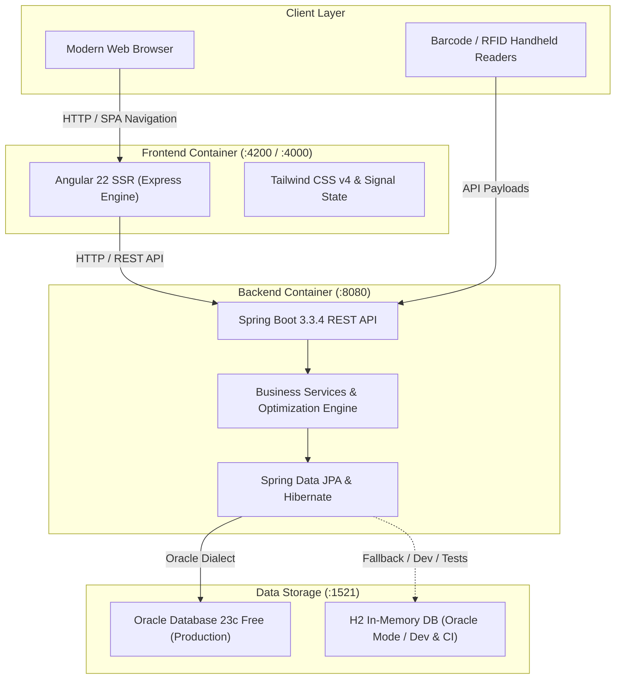

# StockSmart: Retail Inventory Optimization & Management System

[](.github/workflows/ci.yml)


StockSmart is a full-stack, enterprise-grade **Retail Inventory Optimization and Management System** designed for omnichannel retailers, multi-location distribution networks, and modern warehouses. It unifies catalog management, multi-store stock tracking, replenishment, sales fulfillment, barcode/RFID scanning, and automated reorder recommendations into a responsive application.

---

## 📐 System Architecture



---

## 🗂️ Project Structure

```
stocksmart/
├── .github/
│   └── workflows/
│       └── ci.yml               # GitHub Actions CI pipeline (build, test, docker)
├── docker-compose.yml           # Root orchestration for Oracle DB, Backend & Frontend
├── .gitignore                   # Root git exclusion rules
├── README.md                    # Project documentation (this file)
│
├── frontend/                    # Angular 22 Client Application
│   ├── Dockerfile               # Multi-stage production container build
│   ├── .dockerignore
│   ├── angular.json             # Angular CLI workspace configuration
│   ├── package.json             # Dependencies and npm scripts
│   ├── src/
│   │   ├── app/
│   │   │   ├── core/            # Navbars, sidebars, alerts, API configuration
│   │   │   ├── pages/           # Dashboard, products, inventory, transfers, scanner, etc.
│   │   │   ├── app.ts           # Root component
│   │   │   └── app.routes.ts    # Application route definitions
│   │   ├── main.ts              # Browser bootstrap
│   │   ├── main.server.ts       # Server-side bootstrap
│   │   └── server.ts            # Node Express SSR server entrypoint
│   └── README.md                # Frontend specific documentation
│
└── inventory/                   # Spring Boot 3.3.4 Backend Application
    ├── Dockerfile               # Multi-stage Java 21 container build
    ├── pom.xml                  # Maven dependencies & build plugins
    ├── mvnw / mvnw.cmd          # Maven wrapper binaries
    ├── src/
    │   ├── main/
    │   │   ├── java/com/armanmaurya/inventory/
    │   │   │   ├── controller/  # REST API endpoints
    │   │   │   ├── dto/         # Request & response data transfer objects
    │   │   │   ├── entity/      # JPA domain models & database schemas
    │   │   │   ├── enums/       # Status & workflow state machines
    │   │   │   ├── exception/   # Global exception handling & error responses
    │   │   │   ├── repository/  # Spring Data JPA repositories
    │   │   │   └── service/     # Business logic, audit trail, reorder engine
    │   │   └── resources/
    │   │       ├── application.properties         # Default profile: H2 in-memory
    │   │       └── application-oracle.properties  # Oracle DB production profile
    │   └── test/                # Integration and unit tests
    └── README.md                # Backend specific documentation
```

---

## ⚡ Key Capabilities & Modules

1. **Retail Operations Dashboard (`/dashboard`)**:
   - Total catalog SKUs, store/distribution center counts, and units on hand.
   - Financial valuation at Cost vs. Retail prices, gross margin ($), and markup %.
   - Real-time stock health indicators (Low Stock and Out-of-Stock alerts).
   - Live activity stream of receipts, shipments, transfers, and corrections.

2. **Product Catalog & Master Data (`/products`)**:
   - SKU, category, brand, unit cost, and selling price management.
   - Dedicated indexing and lookup for **UPC/EAN Barcodes** and **RFID EPC Tags**.
   - Live search, filtering, creation, and soft-deletion.

3. **Multi-Location Stock Control (`/inventory`)**:
   - Tracks stock across Central Warehouses, Flagship Stores, and Outlet Centers.
   - Multi-tier metric visibility: `quantityOnHand`, `quantityReserved`, and `availableQuantity`.
   - Granular aisle/bin location tagging.
   - Audited stock adjustments with mandatory reason codes (`DAMAGED_GOODS`, `EXPIRED_STOCK`, `SHRINKAGE_THEFT`, `CYCLE_COUNT_VARIANCE`, `SYSTEM_CORRECTION`).
   - Immutable audit movement ledger.

4. **Inter-Store Transfers (`/transfers`)**:
   - Four-stage lifecycle state machine:
     $$\text{REQUESTED} \longrightarrow \text{APPROVED} \longrightarrow \text{IN\_TRANSIT} \longrightarrow \text{RECEIVED}$$
   - Auto-deducts source warehouse inventory upon dispatch and increments destination inventory upon arrival.

5. **Supplier Replenishment & Purchase Orders (`/purchase-orders`)**:
   - Supplier directories with lead times and ratings.
   - Dynamic PO builder with automatic cost calculation.
   - Itemized Goods Receipt modal that increments physical inventory upon receiving.

6. **Customer Sales Orders (`/sales-orders`)**:
   - POS and customer order management with inventory reservation.
   - Fulfillment workflow (`PENDING` $\rightarrow$ `CONFIRMED` $\rightarrow$ `PACKED` $\rightarrow$ `SHIPPED` $\rightarrow$ `DELIVERED`).

7. **Hardware-Ready Scanner Hub (`/scanner`)**:
   - **Barcode Quick Scan**: Instant product discovery, local inventory, and multi-location availability matrix.
   - **RFID Batch Scan**: Bulk RFID tag reader simulation flagging unknown tags and discrepancies.
   - **Cycle Count Audits**: Physical stocktake verification with automated discrepancy reconciliation (`reconcile=true`).

8. **Inventory Optimization Engine (`/reports`)**:
   - Algorithmic replenishment recommendations based on reorder points, safety stock, maximum warehouse capacities, and supplier lead times.
   - Urgency prioritization: `CRITICAL`, `HIGH`, and `MEDIUM`.

---

## 🐳 Quickstart with Docker Compose

Run the entire application stack (Oracle DB 23c Free, Spring Boot backend, and Angular frontend) with one command from the project root:

```bash
docker compose up --build
```

### Deployed Services

| Service | Container Name | Host Port | Internal Port | Description |
|---|---|---|---|---|
| **Frontend** (`frontend`) | `frontend` | `4200` | `4000` | Angular 22 SSR Application |
| **Backend** (`smartstock-backend`) | `smartstock-backend` | `8080` | `8080` | Spring Boot 3.3.4 REST API |
| **Database** (`smartstock-db`) | `smartstock-db`| `1521` | `1521` | Oracle Database 23c Free (`FREEPDB1`) |

### Accessing the Stack
- **Web Application**: [http://localhost:4200](http://localhost:4200)
- **REST API Endpoints**: [http://localhost:8080/api](http://localhost:8080/api)
- **API Healthcheck**: [http://localhost:8080/api/reports/kpi](http://localhost:8080/api/reports/kpi)

### Tear Down
To stop and remove containers:
```bash
docker compose down
```
To also delete the Oracle Database persistent storage volume:
```bash
docker compose down -v
```

---

## 💻 Local Development Setup (Without Docker)

### Prerequisites
- **Java**: OpenJDK 21 or Eclipse Temurin 21+
- **Node.js**: Node 22 LTS or higher
- **npm**: 10+ (bundled with Node)

---

### 1. Backend Setup

Navigate to the `inventory` directory:
```bash
cd inventory
```

#### Run with H2 Database (Default, Zero-Setup)
The application starts with an in-memory Oracle-compatible database pre-seeded with sample retail records:
```bash
./mvnw spring-boot:run
```

#### Run with Oracle Database
To connect to an external or local Oracle Database:
1. Configure credentials in `src/main/resources/application-oracle.properties`:
   ```properties
   spring.datasource.url=jdbc:oracle:thin:@//localhost:1521/FREEPDB1
   spring.datasource.username=INVENTORY_USER
   spring.datasource.password=inventory_pass
   ```
2. Start using the `oracle` Spring profile:
   ```bash
   ./mvnw spring-boot:run -Dspring-boot.run.profiles=oracle
   ```

#### Run Backend Tests
```bash
./mvnw clean test
```

---

### 2. Frontend Setup

Navigate to the `frontend` directory:
```bash
cd frontend
```

#### Install Dependencies
```bash
npm ci
```

#### Start Development Server
```bash
npm start
# or
ng serve
```
Open [http://localhost:4200](http://localhost:4200) in your browser. Live reloading is enabled by default.

#### Run Frontend Unit Tests
```bash
npm test -- --watch=false
```

#### Build for Production
```bash
npm run build
```
Compiled server and browser assets will be output to `dist/frontend`.

---

## 🔄 Continuous Integration (CI/CD)

The GitHub Actions CI pipeline is defined in [`.github/workflows/ci.yml`](.github/workflows/ci.yml). It automatically triggers on every push and pull request to `main` and `master`:

- **Backend Job**:
  - Sets up Java 21 (Eclipse Temurin) with Maven caching.
  - Compiles and runs all integration and unit tests (`./mvnw clean verify`).
  - Publishes Surefire test execution reports as artifacts.
- **Frontend Job**:
  - Sets up Node.js 22 with npm dependency caching.
  - Installs clean dependencies (`npm ci`).
  - Executes unit tests with Vitest (`npm test -- --watch=false`).
  - Compiles production bundles (`npm run build`).
  - Archives build output artifacts (`dist/frontend`).
- **Docker Validation Job**:
  - Validates `docker-compose.yml` configuration (`docker compose config`).
  - Verifies multi-stage Docker builds for all services.

---

## 📡 Key REST API Reference

| Domain | Method | Endpoint | Description |
|---|---|---|---|
| **Products** | `GET` | `/api/products` | Retrieve all products (search queryable) |
| | `GET` | `/api/products/{id}` | Get product details by ID |
| | `GET` | `/api/products/sku/{sku}` | Lookup product by SKU code |
| | `GET` | `/api/products/barcode/{barcode}` | Lookup product by Barcode |
| | `POST` | `/api/products` | Create a new catalog item |
| | `PUT` | `/api/products/{id}` | Update product information |
| | `DELETE` | `/api/products/{id}` | Soft-delete product |
| **Locations** | `GET` | `/api/locations` | List all stores and distribution centers |
| | `POST` | `/api/locations` | Register a new facility |
| **Inventory** | `GET` | `/api/inventory` | View all stock positions across locations |
| | `GET` | `/api/inventory/low-stock` | Items at or below safety reorder levels |
| | `GET` | `/api/inventory/out-of-stock` | Items with zero available quantity |
| | `POST` | `/api/inventory/adjust` | Record audited inventory adjustments |
| | `GET` | `/api/inventory/movements` | View immutable stock movement log |
| **Transfers** | `GET` | `/api/transfers` | List inter-facility transfer requests |
| | `POST` | `/api/transfers` | Initiate stock transfer request |
| | `PUT` | `/api/transfers/{id}/approve` | Approve transfer order |
| | `PUT` | `/api/transfers/{id}/ship` | Ship goods (deducts source stock) |
| | `PUT` | `/api/transfers/{id}/receive` | Receive goods (adds target stock) |
| **Purchase Orders** | `GET` | `/api/purchase-orders` | List replenishment purchase orders |
| | `POST` | `/api/purchase-orders` | Draft new purchase order |
| | `PUT` | `/api/purchase-orders/{id}/issue`| Issue PO to vendor |
| | `POST` | `/api/purchase-orders/{id}/receive`| Check in goods and update inventory |
| **Sales Orders** | `GET` | `/api/sales-orders` | List retail sales orders |
| | `POST` | `/api/sales-orders` | Create order & allocate inventory |
| | `PUT` | `/api/sales-orders/{id}/fulfill`| Fulfill order & deduct allocated stock |
| **Hardware Scanner** | `GET` | `/api/scanner/barcode/{code}` | Fast barcode scan & multi-store stock |
| | `POST` | `/api/scanner/rfid-batch` | Bulk RFID read ingestion & tally |
| | `POST` | `/api/scanner/cycle-count` | Physical count audit & auto-reconcile |
| **Optimization** | `GET` | `/api/reports/kpi` | Valuation, margins, & performance KPIs |
| | `GET` | `/api/reports/reorder-recommendations` | Automated replenishment suggestions |

---

## 📄 License
This project is licensed under the MIT License.
